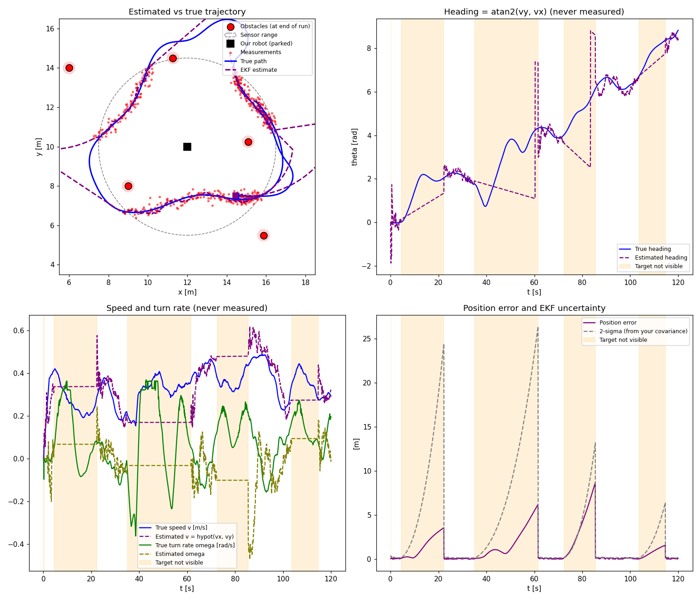

# ED5315 Tutorial 1 - EKF tracking
Use an Extended Kalman Filter as an observer: track another robot that moves in a way you
don't know, from noisy position measurements that drop out whenever it goes out of sight.

## Setup
See the [repository root README](../README.md) for installation and setup.

## The scenario

Our Pioneer is parked at (12, 10) and never moves. A second Pioneer - the **target** - drives
around it on a smooth, random trajectory: its speed and turn rate keep changing, and the
trajectory is different on every run.

Our robot has a tracking sensor that reports the target's position:

- it measures **x and y only** [m], with independent Gaussian noise of standard deviation
  **0.15 m** on each,
- it reports **10 times a second**, but only when there is a **direct line of sight** to the
  target within **4.5 m**. Obstacles in between, or the target simply being too far away, mean
  no measurement at all.

The sensor never reports the target's heading, speed or turn rate. Your EKF has to estimate
them, and keep predicting where the target is while it can't be seen.

## The model

**State** (5 values): position, velocity and turn rate of the target

$$s = [x,\ y,\ v_x,\ v_y,\ \omega]$$

The target's heading and speed are not separate states - they follow from the velocity:
$\theta = \mathrm{atan2}(v_y, v_x)$, $v = \sqrt{v_x^2 + v_y^2}$.

**Motion model**, over a time step $\Delta t$. The target's motion is unknown, so it is modelled
as driven by random noise inputs $\delta = [a_x,\ a_y,\ \alpha]$ - an unknown linear acceleration
in x and y, and an unknown angular acceleration:

$$
\begin{aligned}
x' &= x + v_x \Delta t + \tfrac{1}{2} a_x \Delta t^2 \\
y' &= y + v_y \Delta t + \tfrac{1}{2} a_y \Delta t^2 \\
v_x' &= v_x - \omega v_y \Delta t + a_x \Delta t - \tfrac{1}{2} \alpha v_y \Delta t^2 \\
v_y' &= v_y + \omega v_x \Delta t + a_y \Delta t + \tfrac{1}{2} \alpha v_x \Delta t^2 \\
\omega' &= \omega + \alpha \Delta t
\end{aligned}
$$

The noise inputs have zero mean and covariance $Q = \mathrm{diag}(0.15^2,\ 0.15^2,\ 0.30^2)$ (given
in `EKF_class.py`). The state prediction uses $\delta = 0$.

**Measurement model**: $z = [x,\ y] + \text{noise}$, with covariance $R = \mathrm{diag}(0.15^2,\ 0.15^2)$
(also given).

## In class

Derive, for the model above:

1. $F_p$ - the 5×5 Jacobian of the motion model with respect to the state $s$.
2. $F_\delta$ - the 5×3 Jacobian of the motion model with respect to the noise inputs $\delta$.
3. $H$ - the 2×5 measurement Jacobian.
4. The EKF prediction and correction equations using these.
5. What the filter should do when there is no measurement for a while, and why it can still
   recover $\theta$, $v$ and $\omega$ - none of which are ever measured.

## Task

Complete the `EKF` class in **EKF_class.py** - this is the file you submit.

| Method                      | What it does                                                                     |
|-----------------------------|----------------------------------------------------------------------------------|
| `__init__`                  | set `self.H` (`self.Q` and `self.R` are given)                                    |
| `state_prediction(delta_t)` | move `self.state` forward by `delta_t` with the motion model ($\delta = 0$)       |
| `compute_Fp(delta_t)`       | return $F_p$, evaluated at the current `self.state`                             |
| `compute_Fdelta(delta_t)`   | return $F_\delta$, evaluated at the current `self.state`                          |
| `covariance_prediction(delta_t)` | update `self.covariance` using $F_p$, $F_\delta$ and `self.Q`               |
| `correction(measurement)`   | update `self.state` and `self.covariance` with a measurement `[x, y]`            |

`main.py` (provided - do not modify) runs your filter every simulation step (`delta_t` =
0.05 s): `covariance_prediction` first, then `state_prediction`, so both Jacobians are
evaluated at the state from *before* the step. It calls `correction` only when the sensor
returns a measurement - while the target is out of sight, your filter runs on prediction
alone.

## Instructions

1. Download the setup provided in this repository (or `git pull` if you already have it).

2. Complete **EKF_class.py**.

3. Launch CoppeliaSim. Click File -> Open Scene, and open the shared
   [`scenes/mobile_robot.ttt`](../scenes/mobile_robot.ttt). You don't need to press play -
   `main.py` parks our robot, adds the target and starts the simulation itself.

4. From the repository root, run `python Tutorial_1/main.py`. A run takes 120 s of simulation
   time. When it ends, the target is removed and our robot goes back to where it was.

5. The result is saved to `Tutorial_1/result.png`, and error statistics are printed. To repeat
   the same target trajectory (for example while debugging), set `SEED` at the top of
   `main.py` to an integer.

6. If a run is interrupted and the scene looks wrong afterwards (a second robot left behind, or
   our robot out of place), reload `scenes/mobile_robot.ttt` without saving.

## What you should see

A sample output from a working filter:

- **Top left:** while the target is visible, the estimate (purple, dashed) follows the true
  path (blue) closely - noticeably smoother than the raw measurements (red). Out of sight,
  the estimate carries on along its last known speed and turn rate, drifting away from the
  truth until the target is seen again.
- **Top right, bottom left:** heading, speed and turn rate are never measured, but the
  estimates follow the truth while the target is visible. Shaded bands are times when the
  target was out of sight.
- **Bottom right:** the position error, and the uncertainty your filter reports (2σ from
  its covariance). The uncertainty should grow while the target is out of sight and collapse
  as soon as it is seen again - and the error should stay mostly below it.

## Submission

**EKF_class.py** is the only file you submit, and the only one that's graded. It is graded
without the simulator: each method is checked against the model above, using fixed states
and measurements.

## Files

| File                | Role                                                                     |
|---------------------|--------------------------------------------------------------------------|
| `EKF_class.py`      | **Your EKF** - complete and submit                                       |
| `main.py`           | Runs the tracking experiment and plots the result - do not modify        |
| `target_driver.py`  | Adds the target robot and drives it randomly - do not modify             |
| `target_sensor.py`  | The line-of-sight tracking sensor - do not modify                        |
